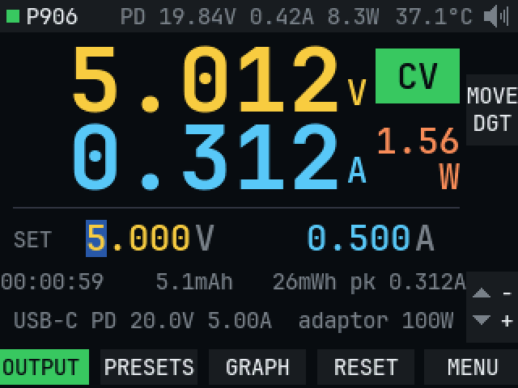
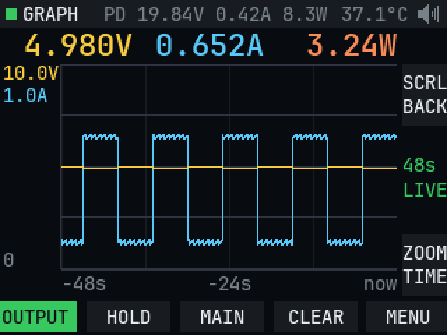

# MDP-P906 recovery and firmware notes

Notes, backups and tools from recovering a Miniware **MDP-P906** (board `P906-DIG-2.2`, STM32F103VCT6) from a DFU-only soft brick, plus reverse-engineering notes on its bootloader and v3.01 firmware.

## Contents

| Path | What it is |
|---|---|
| `backup/` | Files from the P906's `P906_APP` drive before it was formatted (`*.CFG`/`*.PRM` calibration/config, `Q_SET.TXT`, `RX_ADDR.TXT`) |
| `patched/M01_open_firmware.hex` | Compiled open M01 firmware from `m01fw/`. Flash over SWD; not tried through the M01's DFU bootloader. |
| `tools/` | Python analysis scripts (capstone-based disassembly, dump analysis, hex patch + verify) |
| `notes/claude-memory/` | Condensed findings kept as project memory |
| `photos/` | Board photos (P906 MCU area, USB-C input area, P906 DC/DC board, M01 mainboard V1.3) |
| `m01fw/` | Open replacement firmware for the M01 (work in progress). Hardware map and findings are in `notes/m01-hardware.md`. |

Not included: the MDP PC software (`MDPUpperV1.2.zip`, 135 MB) and the STM32CubeProgrammer installer. Both are too large for GitHub and come from their vendors.

Miniware's firmware is **not redistributed here**: no stock packages, flash dumps or patched P906 images. Download the stock `MDP_P906_v3.01.hex` from Miniware, then build the patched images yourself with `tools/pdfix.py` and `tools/dfuhex.py`, described below.

## Open M01 firmware

Replacement firmware for the MDP-M01 handheld, with its own UI. See [`m01fw/README.md`](m01fw/README.md). These are rendered by the PC simulator from the real UI code:

| Main | Graph |
|---|---|
|  |  |

## What went wrong

- The DFU update drive wrote firmware images **0x1C00 bytes (14 sectors) too low**. `0x08008000` held mid-image text and no vector table, so the bootloader stayed in DFU on every boot.
- Every attempt still reported `.rdy`, because the bootloader never checks the image it wrote.
- Formatting the `P906_APP` drive was **not** the cause. The unit booted normally after the format.

## How it was fixed (SWD / ST-Link)

1. **Power the MCU properly.** The USB-C port does not power the STM32's 3.3 V rail in this state. Feed the ST-Link's **3.3 V output to the VCC pin of the W25Q64 SPI flash**, which is on the same 3.3 V rail. Without this, SWD fails with "Unable to get core ID", and VDD reads around 2 V because the chip is phantom-powered through the SWD pins.
2. Connect GND, SWDIO (PA13, pin 72), SWCLK (PA14, pin 76) and NRST (pin 14).
3. Read protection (RDP) is **off**. Back up first:
   `STM32_Programmer_CLI -c port=SWD mode=UR reset=HWrst -u 0x08000000 0x40000 backup.bin`
4. Program only the firmware area. The `.hex` carries its own addresses, so only pages 0x08008000–0x0802D7FF are erased:
   `STM32_Programmer_CLI -c port=SWD mode=UR reset=HWrst -d MDP_P906_v3.01.hex -v`
5. Release with `-hardRst`.

To restore a unit exactly (bootloader, firmware and calibration), keep your own full-flash dump from before you change anything and write it at `0x08000000`. Dumps are not in this repo: they are specific to each unit.

## Flash layout

| Range | Contents |
|---|---|
| `0x08000000–0x08006FFF` | Miniware bootloader (`P906_DFU`, `BDFU V3_42_D`, "Virtual DFU Disk") |
| `0x08008000–0x0802D0E7` | Application (v3.01) |
| `0x0803D000–0x0803F7FF` | Calibration / settings pages. **Do not erase.** |

## Bootloader DFU drive: safe USB update procedure

The DFU drive is a FAT12 disk emulated in RAM. Pre-filled dummy entries take clusters 2–14, so the first free data sector is at byte `0x6A00`.

- **`.hex`**: lines are parsed in order and must start with `:` and end in **CRLF**. Line addresses are absolute, so the image can't be shifted.
- **`.ADR`** (then `.bin`): the address is checked (≥ `0x08008000`) and the session switches to bin mode. The bin's start is then **guessed** from fixed thresholds (`0x6C00` right after ADR, otherwise `0x8C00`). The directory entry's real start cluster is ignored. Leftover files on the drive push the `.bin` further along and shift the whole image. That's what bricked this unit.

**Safe procedure:**
1. Power off fully, then enter DFU (hold SET, press MENU/RUN). This gives a fresh session.
2. Copy **only** the `.hex` from the original zip. Don't copy `.ADR`, and don't format, delete or rename anything on the drive.
3. Wait for `.rdy`. `.ERR` or `.NOT` means the update failed: start over.
4. Power-cycle, then check the version on the device info screen. `.rdy` alone proves nothing.

## Firmware findings (v3.01)

- **USB-PD**: understands fixed, PPS and EPR (AVS) offers. It requests 5 V, then the highest voltage up to **20 V**. It enters EPR mode but still requests 20 V (`0x0801ED92: movw r0, #20000`).
- **Input current limit**: a DAC-driven hardware limiter set to the negotiated PD current, minus a small margin. "Unlimit" means "the charger's advertised current", not truly unlimited. Anything above **3 A needs a 5 A e-marked cable**. Confirmed: MAX 5.00 A with a strong charger and a good cable, so 100 W in.
- **Current Limit Mode** (Normal / Unlimit) only toggles GPIO **PE5**.
- **28 V patch** (not included): a one-instruction change, 20000 → 28000 mV. **Not flashed.** The USB-C input switch is an **AON7409** (−30 V VDS, ±25 V VGS). That leaves too little margin at 28 V, and the gate may see the full input voltage. The K34 diode is a 40 V Schottky and isn't the issue. Treat **20 V × 5 A** as the USB-C ceiling, and use the 30 V barrel jack for more power.

## USB-PD charger compatibility patch

Some USB-C chargers never trigger 20 V on stock v3.01. There are two main causes:

1. **Attach detection.** The firmware only treats a charger as connected if its CC pull-up advertises at least 1.5 A (`cmp r0,#2` on FUSB302 BC_LVL at `0x080219F8`). Chargers that advertise "Default USB" current fail with `fusb3022 CC1 or CC2 error`, and PD never starts.
2. **Missing protocol replies.** The receive handler (`0x0801EBC0`) only reacts to Accept, PS_RDY, Source_Capabilities and the EPR messages. Soft_Reset, Get_Sink_Cap, VDM requests and other PD 3.0 requests get no answer. Strict chargers respond with Soft_Reset and then Hard_Reset. A Hard_Reset cuts VBUS and reboots the unit, and some chargers then give up. Reject and Wait are also ignored.

Smaller issues: the FUSB302 never retries a transmission (`Control3 = 0x06`). The Request is sent from the main loop, so it can miss the charger's ~30 ms deadline. Only `Interrupt` is cleared in the ISR, so a latched `InterruptA`/`InterruptB` bit could hold INT_N low.

`tools/pdfix.py MDP_P906_v3.01.hex out.hex` makes these changes. It checks the original bytes before writing anything.

| Where | Change |
|---|---|
| `0x080219F8` | CC detect accepts BC_LVL ≥ 1, so any Rp works |
| `0x08021A16` | FUSB302 `Control3 = 0x07`: hardware auto-retry, 3 retries |
| `0x0801EC7E` | Receive dispatcher hooked to new code. It answers **Soft_Reset** (Accept, reset MessageID, renegotiate) and **Get_Sink_Cap** (5 V 3 A + 20 V 5 A). It sends **Reject** for swaps. For Get_Source_Cap, Data_Reset, PD 3 requests and VDM requests it sends **Not_Supported** (on PD 2.0 sources: Reject, or nothing for unknown and VDM messages). After **Wait** it retries the same request after ~150 ms. After **Reject** it clears the stuck "request pending" flag. Everything else goes to the original handler. |
| `0x08021966` | FUSB302 EXTI hooked: the Request is sent straight from the interrupt about 1 ms after Source_Capabilities, and `InterruptA`/`InterruptB` are cleared |
| `0x0801EE94` | The main-loop PD tick runs with EXTI15_10 (IRQ40) masked, so the interrupt can't break a bit-banged I2C transfer |
| `0x08021A42`, `0x08021A80` | FUSB302 `Switches1`: AUTO_CRC on from init, so the charger's first Source_Capabilities gets a GoodCRC (stock turned it on only after the first offer, forcing a resend) |
| `0x0801EC2E` | The first Source_Capabilities is used straight away (stock ignored it in state 0) |
| `0x0801ECD0` | First request is 20 V instead of 5 V then 20 V, one voltage change instead of two |
| `0x0801E384`, `0x0801E3DA` | PDO picker prefers a fixed PDO: PPS/AVS is only used when no fixed PDO matches the target voltage (stock chose PPS at 20 V whenever a charger offered PPS up to ≥ 20 V) |
| `0x0801ED02`, `0x0801ED3C` | The 3 s PPS keep-alive re-request only runs when the contract really is PPS (stock re-sent a PPS request even after picking fixed 20 V, which switched the contract to PPS). Stock timed the keep-alive by adding 4 ms per main-loop tick, so with a slow main loop it could miss the charger's 15 s PPS timeout. That is a likely cause of random cut-outs on PPS chargers. |
| `0x08019D7C` | Version string `3.01` → `3.01PD`, so patched firmware is recognisable on the info screen |
| `0x0802D100–0x0802D2B3` | New code (436 bytes) in unused flash after the app |

Not changed: Hard_Reset is still not detected; a Hard_Reset drops VBUS, so the unit reboots anyway.

Flash it over SWD as in the recovery section. The `.hex` erases only app pages, and calibration at `0x0803D000` is untouched:
`STM32_Programmer_CLI -c port=SWD mode=UR reset=HWrst -d out.hex -v`
To undo it, flash the stock `MDP_P906_v3.01.hex`.

## DFU `.ERR` on current Windows, and the `_dfu.hex` files

The bootloader doesn't read the copied file. It parses the raw sector writes to its virtual drive. If it sees the `.HEX` directory entry first, it parses from the file's first sector (disk offset `0x6A00`). If the data arrives before the directory entry, it ignores writes below `0x7A00` and starts parsing there. That is 4 KB into a file starting at `0x6A00`, usually mid-line, so the result is `.ERR`. Current Windows writes data first, so even the stock `.hex` fails.

`tools/dfuhex.py in.hex out.hex` lays the file out so it doesn't matter:
- Every 512-byte sector starts exactly on a `:`.
- The first 4 KB holds only records the bootloader ignores.
- Data records are at most 16 bytes, with even addresses and lengths.

`tools/blsim.py` confirms that both `_dfu.hex` files give `.rdy` with the correct flash contents whether parsing starts at the beginning or 1–8 sectors in. The original `.hex` fails when parsing starts 8 sectors in.

## Fan control (v3.01, not modified)

`0x080179F8`, run from the measurement round-robin in the main loop:

- **Sensor:** an NTC on ADC channel 2, converted with a 160-entry lookup table (`0x0802AB54`) to −1…79 °C in 0.5 °C steps. An ADC value outside `0x1DD–0xCF0` (open or shorted NTC) reads as −1 °C.
- **Fan drive:** TIM4 PWM at 25 kHz, the standard for 4-pin fans. The duty is written to TIM4 CCR2.
- **Curve:**
  - below 40 °C: 0 %
  - from 40 °C: `duty = (T − 39) × 6 %`, so 6 % at 40 °C, 66 % at 50 °C, 100 % from about 55.7 °C
  - no hysteresis, so near 40 °C it switches between 0 % and 6 %
- **Over-temperature:** at ≥ 70 °C, or ≤ 0 °C (which includes a sensor fault and also a genuinely cold room), the output is switched off and an error is shown.
- **Boot check (`0x080182F0`):** the fan starts at 100 % during hardware init. The tach input (PE2) must show at least 21 high and 21 low samples within 40,000 polls, otherwise `FAN ERROR` is shown until a key is pressed.

