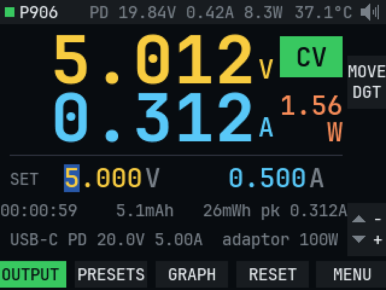
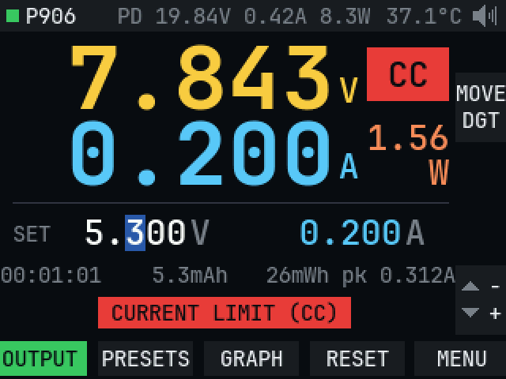
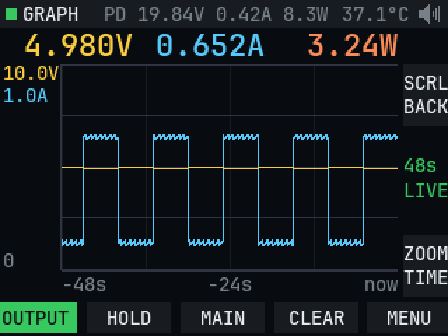
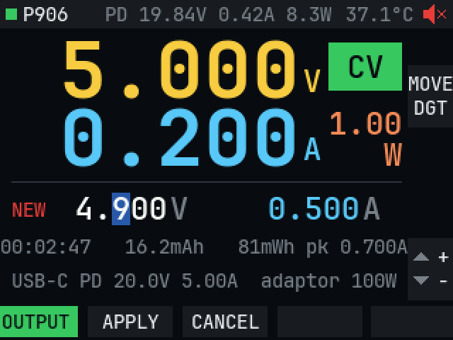
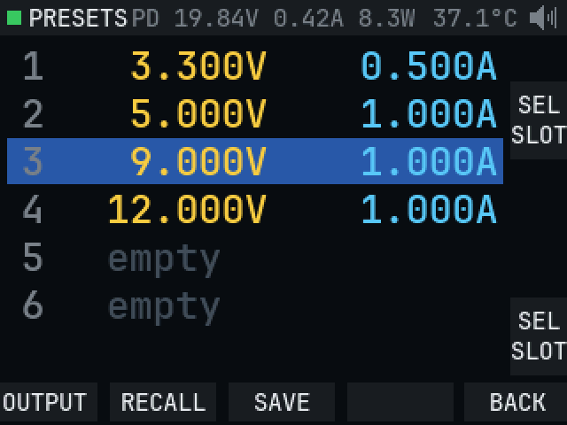
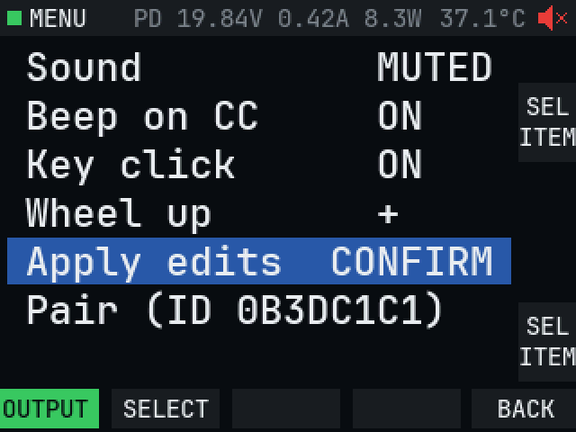

# Open firmware for the MDP-M01

Replacement firmware for the Miniware MDP-M01 handheld (GD32F303VET6), used to control an MDP-P906 over its radio link. Work in progress. The stock bootloader is kept, and the app starts at `0x08008000`.

These screenshots are rendered by the PC simulator (`sim/`) from the real UI code, so the values are simulated.

| Main page | Current limit |
|---|---|
|  |  |

| Graph | Confirm before applying |
|---|---|
|  |  |

| Presets | Menu |
|---|---|
|  |  |

## Controls

Key A switches the output on every page. The strip on the right edge shows what each wheel does on the current page.

| Page | Wheels | Keys |
|---|---|---|
| Main | MENU moves the digit cursor, VALUE changes the digit | B presets, C graph, D reset session counters, E menu |
| Graph | MENU scrolls back, VALUE changes the time window | B hold/run, C main, D clear, E menu |
| Presets | Select a slot | B recall, C save, E back |
| Menu | Select an item | B select, E back |

The menu sets the VALUE wheel direction and whether edits apply live. With **Apply edits: CONFIRM**, a changed voltage or current waits on screen until you press B (APPLY) or C (CANCEL).

Showing the USB-PD contract and adaptor power needs the P906 patch built by `tools/pdfix.py`. Without it the rest of the firmware still works.

## Build and flash

Needs the Arm GNU Toolchain, CMake and Ninja. The compiled image is also at `patched/M01_open_firmware.hex` in this repo.

Back up your M01 flash over SWD before flashing anything. SWD is on the micro-USB D+ (SWDIO) and D- (SWCLK) lines; see `notes/m01-hardware.md`.

```
STM32_Programmer_CLI -c port=SWD mode=NORMAL reset=SWrst -d build/m01fw.hex -v -rst
```

`sim/render.sh` builds the simulator, runs its UI checks and writes screenshots to `sim/out/`.
